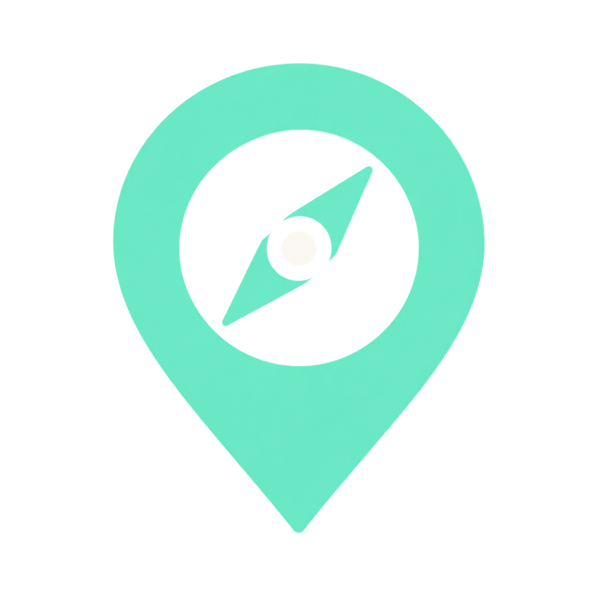

<div align="center">
  
  <h1>Repère</h1>
  <p>La carte, la ville et le pays du panorama WorldGuessr, directement dans le volet Chrome.</p>
  <p><strong>Chrome 116+</strong> · <strong>Version 1.8.2</strong> · <strong>Sans clé API</strong></p>
  <p><a href="#installation">Installation</a> · <a href="#utilisation">Utilisation</a> · <a href="#dépannage">Dépannage</a></p>
</div>

---

## Ce que fait Repère

- Détecte automatiquement les coordonnées du panorama de l’onglet actif.
- Affiche la **ville ou localité**, le **pays** et son **drapeau**.
- Centre une **carte interactive sombre** sur le lieu, avec zoom et déplacement.
- Privilégie les noms français lorsqu’ils sont disponibles.
- Permet de copier les coordonnées ou d’ouvrir le lieu dans Google Maps et OpenStreetMap.

Le volet reste à côté du jeu. Il actualise la position au changement de manche et conserve ton zoom entre deux lectures du même lieu.

## Installation

Aucune compilation ni installation de dépendances n’est nécessaire : les bibliothèques et les icônes sont incluses.

1. Télécharge ou clone ce projet, puis décompresse-le si nécessaire.
2. Ouvre `chrome://extensions` dans Chrome.
3. Active le **Mode développeur**.
4. Clique sur **Charger l’extension non empaquetée**.
5. Sélectionne le dossier contenant [manifest.json](manifest.json).
6. Ouvre [WorldGuessr](https://www.worldguessr.com), puis recharge la page si elle était déjà ouverte.
7. Lance une manche et clique sur l’icône **Repère** dans la barre des extensions.

Pour retrouver l’icône facilement, épingle Repère depuis le menu des extensions de Chrome.

## Utilisation

| Dans le volet | Action |
| --- | --- |
| Ville, pays et drapeau | Identifient le lieu détecté. |
| Carte | Fais glisser pour te déplacer ; utilise **+ / −** pour zoomer. |
| Coordonnées | Latitude et longitude du panorama. |
| **Copier** | Copie les coordonnées dans le presse-papiers. |
| **Google Maps ↗ / OpenStreetMap ↗** | Ouvre le lieu dans un nouvel onglet. |

La détection fonctionne tant que le volet est ouvert, environ toutes les **1,2 seconde**. Changer d’onglet ou recharger la page masque la position précédente.

### Mettre à jour l’extension

Remplace les fichiers dans le même dossier, clique sur **Recharger** dans `chrome://extensions`, puis recharge WorldGuessr et rouvre le volet.

## Dépannage

| Problème | À vérifier |
| --- | --- |
| **En attente du panorama…** | Lance une manche et attends le chargement de Street View. |
| **Aucune position** | L’onglet actif doit être une page WorldGuessr avec un panorama accessible. |
| **Nom indisponible** | Le service de recherche du lieu peut être inaccessible. Les coordonnées restent utilisables. |
| Carte vide ou message d’erreur | Vérifie la connexion et que ton réseau autorise `tiles.openfreemap.org`. Recharge l’extension après une mise à jour. |
| Le volet ne s’ouvre pas | Vérifie que Chrome est en version 116 ou supérieure, puis recharge l’extension. |

## Fonctionnement et limites

Repère lit les coordonnées accessibles dans les cadres WorldGuessr : URL du panorama, messages de changement de manche ou paramètre du cadre Street View visible. Il ne reconnaît pas le lieu à partir de l’image.

La position correspond au point transmis par le jeu. Elle peut différer légèrement du panorama et ne suit pas tes déplacements dans Street View. Si WorldGuessr change son fonctionnement ou masque ses coordonnées, la détection peut devenir indisponible.

La ville et le pays sont obtenus avec **Photon**. Le résultat peut correspondre à une localité voisine, et certains lieux n’ont pas de nom disponible. Les réponses sont mises en cache pendant la session ; une ancienne réponse ne remplace pas le lieu de la manche actuelle.

La carte utilise **OpenFreeMap** et **MapLibre GL JS**. Les libellés français disponibles sont affichés en priorité, avec repli sur le nom latin ou local. Une connexion Internet est nécessaire pour la carte et les noms des lieux.

## Données et permissions

Repère ne conserve pas d’historique des lieux. Les notes et le carnet ne font plus partie de l’extension.

| Permission | Usage |
| --- | --- |
| `activeTab` | Accéder à l’onglet sélectionné après ouverture de l’extension. |
| `scripting` | Lire les coordonnées dans les cadres du jeu. |
| `sidePanel` | Afficher le volet à côté de WorldGuessr. |
| `https://*.worldguessr.com/*` | Activer le lecteur sur WorldGuessr et ses sous-domaines. |
| `https://photon.komoot.io/*` | Obtenir la ville et le pays à partir des coordonnées. |

Les coordonnées détectées sont envoyées à **Photon** pour identifier le lieu. Les requêtes de carte sont envoyées à **OpenFreeMap** et révèlent la zone consultée. Cliquer sur un lien Google Maps ou OpenStreetMap transmet la position au service choisi. Les drapeaux et les icônes sont chargés depuis les fichiers de l’extension.

## Structure du projet

```text
.
├── manifest.json          Configuration de l’extension
├── background.js          Ouverture du volet au clic
├── content.js             Lecture des coordonnées dans le jeu
├── popup.html             Interface du volet
├── popup.js               Détection, noms des lieux et copie
├── map.js                 Carte, repère et redimensionnement
├── style.css              Thème sombre
├── assets/                Logo, icônes et style de carte
└── vendor/                Bibliothèques, drapeaux et licences
```

## Crédits

- [MapLibre GL JS](https://maplibre.org/) — rendu de la carte ; [licence incluse](vendor/maplibre/LICENSE.txt).
- [OpenFreeMap](https://openfreemap.org/) — hébergement des données de carte.
- [OpenMapTiles](https://www.openmaptiles.org/) et [OpenStreetMap](https://www.openstreetmap.org/copyright) — données cartographiques ; crédits visibles sur la carte.
- [Photon](https://github.com/komoot/photon) — recherche des noms de lieux.
- [flag-icons](https://github.com/lipis/flag-icons) — drapeaux SVG ; [licence incluse](vendor/flags/LICENSE).

Repère est un projet indépendant, sans affiliation à WorldGuessr.
